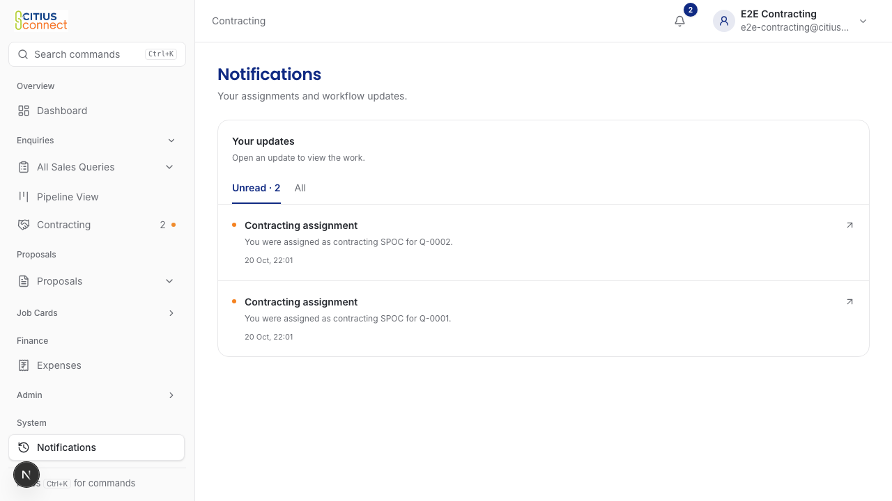
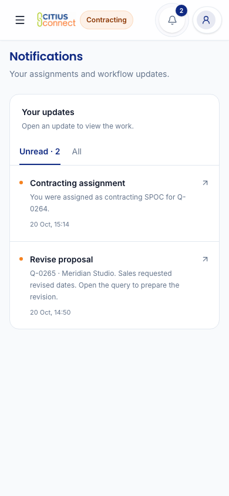
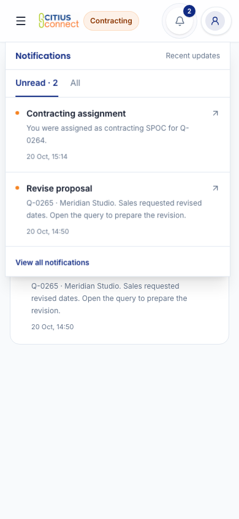
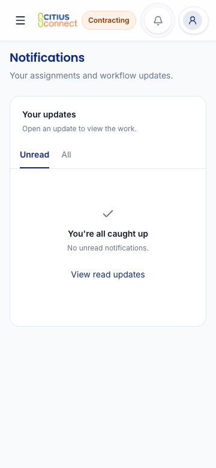
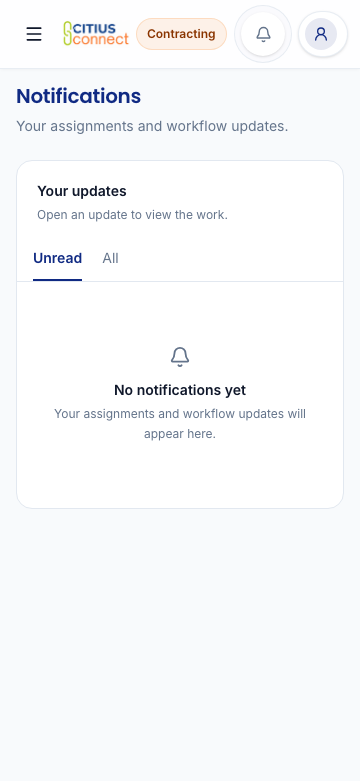
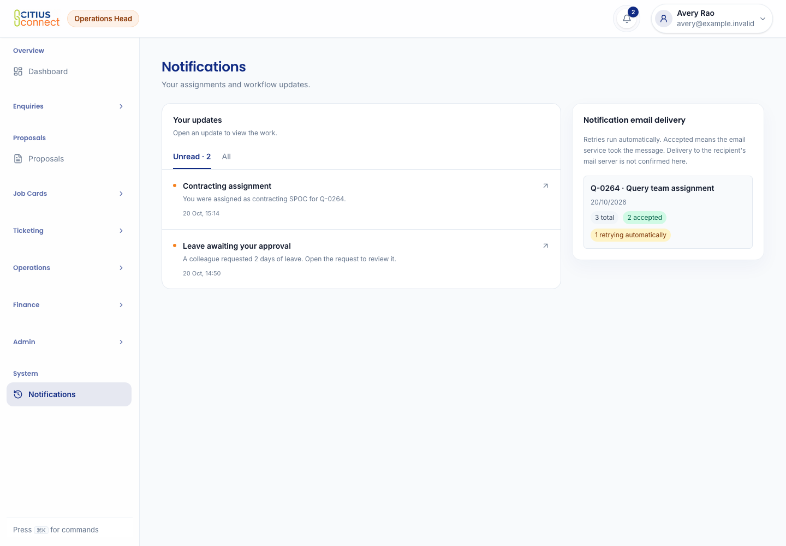
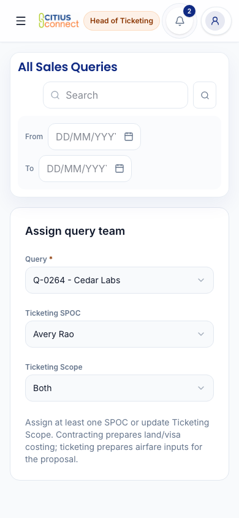
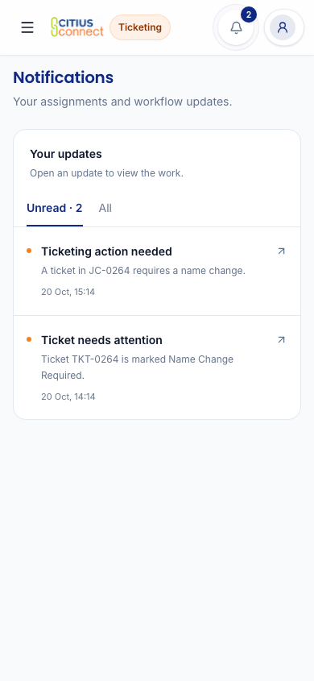
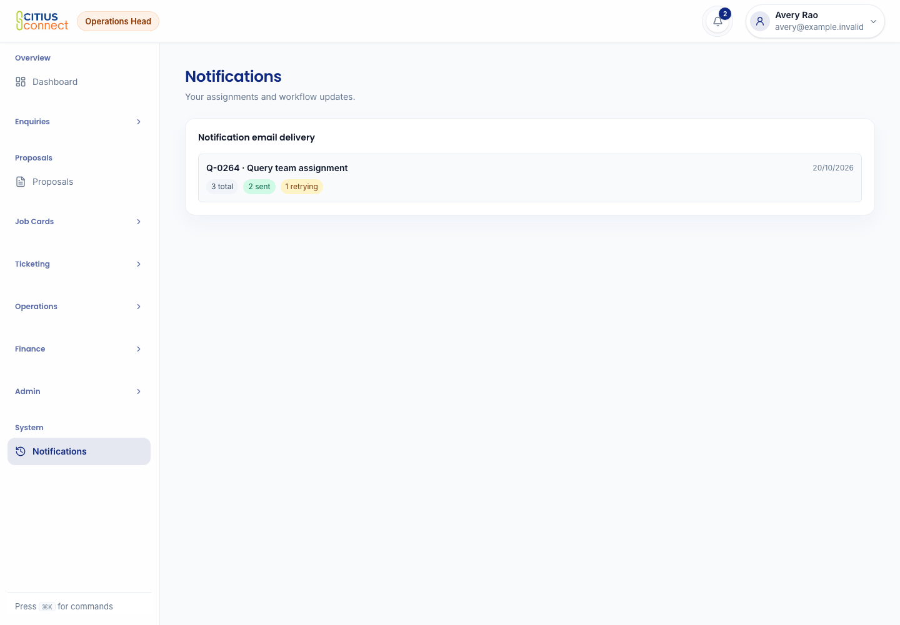
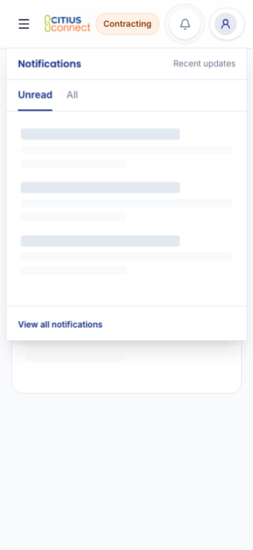

# Citius usability, notification and email review

Start with the [staff task guide](staff-guide.md) for detailed steps, complete pictures, alert audiences and the internal report diagram. The event rules and confirmed decisions below keep their review IDs.

[U13. The requested internal post-tour form](../post-tour-report.md) adds the six-section report, JC dropdown, selected alerts and Admin archive/restore. Its pictures use native GitHub attachments.

1. Start with the [complete picture walkthrough](screenshot-walkthrough.md). It covers the changed screens and states, with desktop and phone pictures and an explicit coverage inventory.
2. Open the [email gallery](email-review.md) for every workflow detail family, authentication and website enquiry. These are browser renders, not delivered messages.
3. Check the recipient rules below. Use their R01 to R15 IDs for precise feedback.
4. Check confirmed decisions D01 to D03. The [CRM review](crm-redesign.md), [public and Account review](site-usability.md) and [local workflow record](local-acceptance.md) retain their stable change IDs and exact limits.

The new local gallery shows the real app signed in with designated test accounts. Earlier component-state and failure-state pictures use component substitutes. All people and trips are fictional. No email was sent during this review. This draft has not been merged or deployed to production.

## What this simplifies

The site usability pass reuses the existing Staff toolbar and forms. Staff can clear collapsed filters directly. Account edits start from current details and survive tab changes. Contact keeps submitted values safe while sending and puts the form before office maps on mobile. Services keeps its circular selector, with choices that fit narrow screens and work from the keyboard. The [coverage map](site-usability.md#coverage) records what changed and the limits of each check.

The bell and Notifications page share the same inbox. Staff choose Unread or All, then open an update to view the work. Temporary email failures recover automatically. Business stages, responsible roles, permissions, approvals, calculations and payments retain their existing meaning.

## The staff inbox

The [current inbox gallery](inbox-review.md) has refreshed desktop and phone pictures plus the exact limits of the Mac browser checks.

Staff open the bell or Notifications, choose Unread or All, and open an update to view the work. Opening the bell or switching filters does not mark anything read. Opening one update marks only that update read. Later arrivals stay unread.

Each assignment opens the relevant query or Job Card. The new owner does not land on a head-only assignment form. Staff can use their personal inbox without access to the administrative activity log. A date filter carried from another screen cannot hide older unread updates.

The inbox has one action per update, to open the work. When all updates have been read, it says "You're all caught up" and offers the read updates. "No notifications yet" appears only when there is no history.

Heads and other already authorized staff can see email counts separately. "Accepted" means the email service took the message. It does not prove inbox delivery or that someone read it. Ordinary staff do not see this panel.

## Recipient rules

These rules describe the reviewed workflows. They do not add a general department CC list. Query intake, ticket attention and reminders use the actual responsibilities described in R02, R10 and R13. Other workflows keep their existing email-alert subscriptions and department-head copies.

### R01. Website enquiry

The existing Sales and Sales Head audience receives the enquiry. The info mailbox keeps its email copy. The two email switches remain separate. This does not introduce a new customer acknowledgement or marketing message.

### R02. Query team assignment

The selected Contracting or Ticketing SPOC receives their assignment. Contracting and Operations heads receive the query-intake handoff by bell and email. Management also receives that intake copy. Management means active staff with the Directors or Admin role. Head of Ticketing receives the intake when Ticketing is required. Other Contracting SPOCs do not receive a team-wide assignment email. Management is not copied on every later event.

### R03. Direct Job Card assignment

The selected Operations, Contracting or Ticketing owner receives their assignment. Heads can choose themselves in their department assignment list and do the work. Head of Ticketing can prepare proposal costing after taking the Ticketing assignment. The update opens the Job Card. It does not add another department or send the new owner to an assignment form.

The actual assignment fields below show a Head of Ticketing selecting themselves as the SPOC. This is sample data. The registered workflow tests separately verify that the head can save the assignment and prepare costing.

### R04. Proposal ready for Sales

The assigned Sales SPOC receives the proposal handoff. If Citius cannot identify one owner, Sales Head receives it for review. The whole Sales team is no longer the fallback.

### R05. Date or destination revision

The assigned Contracting SPOC and required Ticketing SPOC receive the revision request. The relevant heads receive oversight notices. "Not required" does not create new Ticketing work.

### R06. Order lost

The assigned Contracting SPOC and Contracting Head receive the notice. The assigned Ticketing SPOC also receives it when Ticketing is required. Other Contracting staff do not receive this notice.

### R07. Order confirmed

Accounts receives the handoff to open the Job Card. Finance keeps its existing notice. Contracting and Operations heads, assigned Contracting and required Ticketing SPOCs, and required Head of Ticketing receive their handoffs. Unassigned base teams no longer receive the operational confirmation broadcast changed here.

### R08. Job Card opened

Assigned Contracting and required Ticketing SPOCs, Contracting and Operations heads, required Head of Ticketing, the assigned Sales SPOC and Sales Head receive the notice. The staff member identified as Finance Head also receives it. Other base-team staff do not receive this notice. All Finance staff and all Directors are not treated as Finance Head.

### R09. Tour Manager allocated

The selected staff Tour Manager receives the Job Card, trip, dates, destination, pax and reporting context. Other Tour Managers and an automatic Operations CC are excluded. This does not change external Tour Manager invitations.

### R10. Ticket attention

Name-change and reissue alerts go to the assigned Operations and Ticketing SPOCs, along with Operations Head and Head of Ticketing. When a SPOC is unassigned or inactive, the heads retain oversight. Other Operations and Ticketing staff are excluded. Extra email-alert subscriptions do not add recipients. Overlapping roles do not add duplicate bell updates or email copies.

### R11. Expenses

The existing assigned manager, submitting staff member and Finance approval flow receive notices at their current stages. The existing Finance and Directors approval audience remains. The reporting hierarchy is not an automatic CC list for unrelated work.

### R12. Leave

The current configured head approver, distinct final authority when required, HR reviewer and requesting employee receive notices at their current stages. HR final review remains part of the app's approval process. General departments and unrelated managers are excluded. D02 confirms that this process stays as it is.

### R13. Scheduled reminders

Enabled rules, thresholds and repeat limits remain. Recipients are the people responsible for that work and the relevant heads. A saved whole-team setting or extra email-alert subscription cannot add recipients. Settings can pause a reminder or change its threshold, but cannot turn it into a team broadcast.

| Rule ID | Reminder | Recipients |
| --- | --- | --- |
| R13a | Confirmed query needs a Job Card | The selected Job Card creator, if assigned, plus Accounts Head and Finance Head. |
| R13b | Query needs a Contracting SPOC | Contracting Head and Operations Head. |
| R13c | Job Card needs an Operations owner | Operations Head. |
| R13d | Visa readiness before departure | Assigned Operations SPOC and Operations Head. |
| R13e | Ticket readiness before departure | Assigned Ticketing SPOC and Head of Ticketing. |
| R13f | Passport validity blocks departure | Assigned Operations SPOC and Operations Head. |
| R13g | Ticket status needs attention | Assigned Operations and Ticketing SPOCs, Operations Head and Head of Ticketing. |
| R13h | Invoice balance is overdue | Accounts Head and Finance Head. |

If no SPOC is assigned, the relevant heads receive the reminder. Staff must be active and still have access to the record. Finance Head continues to mean the staff member identified by that existing function, not the whole Finance team.

### R14. Account and customer messages

Verification, password reset and staff setup keep their current recipients and expiry rules. Booking, payment and feedback behavior stays as it is. This draft introduces no charge notification, promotional email, automated feedback invitation or thank-you email. Traveller feedback sharing and thank-you drafts remain manual. The U13 internal report has its separately requested submission notices.

### R15. Delayed email and changed responsibilities

Before sending an assignment request or proposal-review request, Citius checks that the recipient still has that assignment. For ticket attention, reminders and query intake, it checks the original work responsibility or actual head/Management role again. Extra email-alert roles do not count for these paths. Other existing role-based email keeps its established subscription rules. A former SPOC or head does not receive the pending request just because another role still lets them view the record. This applies to delayed first sends and retries. Citius does not transfer the old email to someone else.

An informational event, such as an order being marked lost, can still reach the person originally notified after reassignment if that person remains active and can still view the record. Losing record access, changing address or becoming inactive stops pending mail. Earlier notifications remain in the inbox under the existing access rules. An email already accepted by the email service cannot be recalled.

## The emails

The [email gallery](email-review.md) shows all 18 workflow examples, both authentication messages, contact enquiries and the long or missing-details cases. These pictures render the real React Email output locally. They are not inbox-delivery proof.

Workflow email

Authentication email

Every family uses the same Citius header, short context, compact details and clear action. A readable fallback link and plain-text alternative keep the message useful without the button. Existing subjects, recipients, access checks, approval stages and retry behavior remain. Contact mail keeps its Reply-To address. Private cost, document fields, leave reasons and internal notes remain in the portal.

The [desktop and phone pictures](email-review.md) also show contact, Proposal, Job Card, traveller, Ticketing, PNR, passport, visa, flight, seat, invoice, expense, approval, leave, hotel and Tour Manager mail. No Resend setup or real send was needed.

## If email has a problem

If the email service has a temporary problem, Citius tries again automatically. If it cannot tell whether an email went through, it stops rather than risk sending a duplicate. Staff do not need to choose a retry method or resend an uncertain message.

Authorized staff can see counts and the related work without seeing recipient email addresses. "Accepted" confirms that the email service took the message, not that the recipient received or read it.

## Confirmed decisions

1. D01. Management means active Directors plus Admin. The query-intake handoff copies Management because the Activity Flow requires it. This does not add Management to leave, expenses or every notification. Heads can assign work to SPOCs and can take their own department's assignment to do the work themselves.
2. D02. Keep the current leave approval process. Its authority, stages and recipients remain unchanged. The older workbook does not replace the current process.
3. D03. Ticket-attention alerts and scheduled reminders go to assigned SPOCs and the relevant heads. They do not go to the whole team. Unassigned work goes to the relevant heads, and overlapping roles do not create duplicate notices.

## Review limits

The [signed-in local run](local-acceptance.md) passed 28 selected checks and a final keyboard-entry/inbox check. The earlier screenshots use component substitutes where labelled. Neither set proves provider delivery or production configuration. No production action is authorized by this review.

Engineering notes and detailed verification

### Shared implementation

`NotificationInbox` serves the bell and Notifications page. The existing outbox owns retry, deduplication and delivery state. `notificationWorkAudience` resolves the exact staff audience for both publication and dispatch. The wider usability pass reuses `PortalListToolbar`, `ProfileInput` and the current forms. It adds no general workflow framework or new stack.

### Delivery behavior

The workflow stores each recipient's outbox job and privacy-safe queued ledger entry in one Convex transaction. One worker claims a 30-second lease. Provider requests time out after ten seconds. The existing shared rate limiter spaces requests by at least 550 ms. Temporary failures allow at most four attempts.

Retries reuse frozen HTML and the same event-recipient provider key. A receipt ID is required for acceptance. Completion and the ledger update commit together. A valid late receipt can complete an earlier attempt. A stale failure cannot undo acceptance. Recovery stops before the provider's 24-hour idempotency window expires. An accepted app job stays deduplicated after that window. Legacy attempted jobs without their original content or timing stop as uncertain.

The outbox records the original recipient purpose. Assignment fields identify actionable query, Job Card and staff Tour Manager assignments. Role audiences retain their original role set, including existing head expansion and additive email-alert subscriptions. The dispatcher and first-render detail query revalidate that purpose plus active status, address and record access. Query intake, ticket attention and reminders use exact staff targets and a work-purpose contract. Current assignments and actual head/Management roles are checked both before publication and before delayed delivery. Existing role expansion and additional email-alert roles are not used for these audiences. Disabled saved reminder rules stop queued reminder mail. Invoices have no current Finance SPOC field, so overdue-invoice reminders use head oversight rather than treating the original creator as an assignee. Historical staff-targeted event notices keep event purpose. Recognized legacy ticket, reminder and intake jobs also pass the current work-audience check, so an older broad recipient list cannot bypass the confirmed policy. Other older queued jobs without purpose metadata retain their previous record-access checks. No recipient is added during recovery.

Terminal jobs discard recipient addresses and frozen HTML. Public counts expose neither addresses nor provider response bodies. Authentication email keeps its separate token and expiry behavior. The shared provider request now receives cancellation. No provider credentials or remote MCP settings changed.

### Implementation and checks

The confirmed-policy regression suite covers all eight registered reminder rules, the real ticket-status mutation, Management inclusion only for query intake, unrelated-team exclusion, inactive staff, record scope, dual-role deduplication without an auth link, unassigned head fallback, independent bell/email controls, disabled reminders, and lost responsibility before first send or retry. Registered self-assignment and work mutations cover Contracting, Ticketing and Operations heads. Leave source and routing are unchanged by this follow-up.

The screenshots render the actual Citius shell, header, inbox, controls, CSS, root fonts and production email HTML. Only Next navigation and Convex transport are mocked. Browser checks cover Unread/All, one selected read, keyboard focus, dismiss/reopen, late arrivals, dense lists, true empty history, unread-empty with read history, loading, the existing error banner and mobile overflow. Source and image hashes are in [browser-evidence.json](browser-evidence.json).

The first hosted coverage run exposed two DocumentPreviewHost timing failures. The tests now wait for bounded visible states instead of a fixed delay. Failed tests unmount their roots before the next case. Their request-count, no-prefetch and explicit-retry assertions remain intact.

Schema-backed tests exercise real registered queue mutations and dispatcher behavior. They cover replay, claim exclusion, immutable content, account and access changes, purpose loss despite broad access, delayed first delivery, retry, historical informational notices, provider receipts, late completion and atomic rollback. The Job Card assignment-link regression first failed for Operations, Contracting and Ticketing, then passed after the production publisher fix. The proposal-owner regression also failed before its audience fix.

Controlled source mutations separately remove lease protection, immutable-content reuse and the access recheck. Each fails its behavior test. Purpose-check mutation evidence separately proves the new broad-access regression. Evidence is in [mutation-evidence.json](mutation-evidence.json). Ordinary passing tests are not mutation evidence.

The final PR records the exact revision, full local gates and hosted result. Target-neutral checks do not prove deployment. The selected authenticated workflows passed on a fresh local backend. Hosted and production changes remain subject to the repository release process.

Effect remains limited to existing orchestration uses under ADR 0004 and is pinned to 4.0.5. The production-test runner now completes bounded asynchronous cleanup during interruption and catches construction defects. Next.js, Convex, auth, approvals, payments and deployment architecture remain in place.

### Business sources

The review used Activity Flow - citius.xlsx, Activity Flow - citius 1.0.xlsx, reporting team citius connect.xlsx and Leave_Approval_Flow 2026_1.0.xlsx. Relevant cells include Contracting Team B12/B13/C20 and Accounts C14, plus Level 1, Final Authority and HR-copy columns in the July leave matrix. The reporting hierarchy was supplied for leave and expenses, not every event.

June and July correspondence distinguished bell alerts from email, required selected Contracting staff plus heads, requested assigned Tour Manager trip context and reported Ticketing/revision gaps. Current code and later workflow decisions were checked before treating those reports as current defects. Raw workbooks and mailbox extracts are not committed.

### Previous components

The previous activity component below uses the same sample data. For this Operations Head it hid the personal inbox while showing email diagnostics. The previous administrator list put a red Delete action beside every update.

