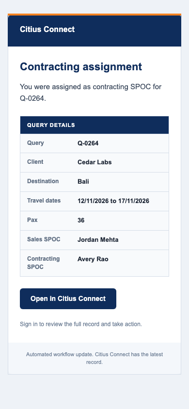
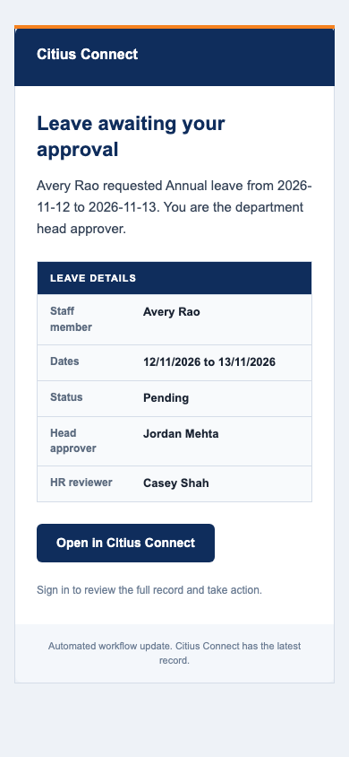
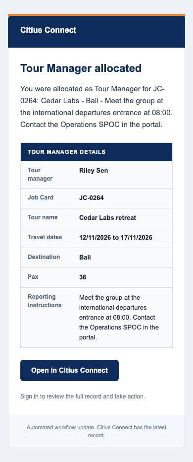

# Notification and email review

Please review these three items before this draft can move forward.

1. Check that the inbox and emails give staff the information they need.
2. Check each recipient rule below. Every rule has a short ID so you can request a precise change, for example, "R04: also notify the Sales Head."
3. Resolve decisions D01 to D03. The draft keeps the current policy where the source documents disagree or leave a group undefined.

The screenshots show working Citius components with sample data, not a live signed-in account. All people and trips are fictional. No email was sent during this review. This draft has not been merged or deployed to production.

## The staff inbox

Staff open the bell or Notifications, choose Unread or All, and open an update to view the work. Opening the bell or switching filters does not mark anything read. Opening one update marks only that update read. Later arrivals stay unread.

Each assignment opens the relevant query or Job Card. The new owner does not land on a head-only assignment form. Staff can use their personal inbox without access to the administrative activity log. A date filter carried from another screen cannot hide older unread updates.

The inbox has one action per update, to open the work. When all updates have been read, it says "You're all caught up" and offers the read updates. "No notifications yet" appears only when there is no history.

Heads and other already authorized staff can see email counts separately. "Accepted" means the email service took the message. It does not prove inbox delivery or that someone read it. Ordinary staff do not see this panel.

## Recipient rules

These rules describe the reviewed workflows. They do not add a general department CC list. Existing email-alert subscriptions and department-head copies still apply where a rule names a role.

### R01. Website enquiry

The existing Sales and Sales Head audience receives the enquiry. The info mailbox keeps its email copy. The two email switches remain separate. This does not introduce a new customer acknowledgement or marketing message.

### R02. Query team assignment

The selected Contracting or Ticketing SPOC receives their assignment. Contracting and Operations heads receive the assignment handoff by bell and email. Head of Ticketing receives the initial unassigned work when Ticketing is required. Other Contracting SPOCs do not receive a team-wide assignment email.

### R03. Direct Job Card assignment

The selected Operations, Contracting or Ticketing owner receives their assignment. The update opens that Job Card. It does not add another department or send the recipient to an assignment form.

### R04. Proposal ready for Sales

The assigned Sales SPOC receives the proposal handoff. If Citius cannot identify one owner, Sales Head receives it for review. The whole Sales team is no longer the fallback.

### R05. Date or destination revision

The assigned Contracting SPOC and required Ticketing SPOC receive the revision request. The relevant heads receive oversight notices. "Not required" does not create new Ticketing work.

### R06. Order lost

The assigned Contracting SPOC and Contracting Head receive the notice. The assigned Ticketing SPOC also receives it when Ticketing is required. Other Contracting staff do not receive this notice.

### R07. Order confirmed

Accounts receives the handoff to open the Job Card. Finance keeps its existing notice. Contracting and Operations heads, assigned Contracting and required Ticketing SPOCs, and required Head of Ticketing receive their handoffs. Unassigned base teams no longer receive the operational confirmation broadcast changed here.

### R08. Job Card opened

Assigned Contracting and required Ticketing SPOCs, Contracting and Operations heads, required Head of Ticketing, the assigned Sales SPOC and Sales Head receive the notice. The staff member identified as Finance Head also receives it. Other base-team staff do not receive this notice. All Finance staff and all Directors are not treated as Finance Head.

### R09. Tour Manager allocated

The selected staff Tour Manager receives the Job Card, trip, dates, destination, pax and reporting context. Other Tour Managers and an automatic Operations CC are excluded. This does not change external Tour Manager invitations.

### R10. Ticket attention

The existing Operations and Operations Head audience remains. Recipients must still have access to the Job Card. Decision D03 covers whether this existing subscription should become assignment-only.

### R11. Expenses

The existing assigned manager, submitting staff member and Finance approval flow receive notices at their current stages. The existing Finance and Directors approval audience remains. The reporting hierarchy is not an automatic CC list for unrelated work.

### R12. Leave

The current configured head approver, distinct final authority when required, HR reviewer and requesting employee receive notices at their current stages. HR final review remains part of the app's approval process. General departments and unrelated managers are excluded. Decision D02 covers the disagreement with the July workbook.

### R13. Scheduled reminders

Existing enabled rules, recipient roles and repeat limits remain. This does not create more frequent reminders or new email campaigns. Decision D03 covers the existing role subscriptions.

### R14. Account and customer messages

Verification, password reset and staff setup keep their current recipients and expiry rules. Booking, payment and feedback behavior stays as it is. This draft introduces no charge notification, promotional email, automated feedback invitation or thank-you email. Feedback sharing and thank-you drafts remain manual.

### R15. Delayed email and changed responsibilities

Before sending an assignment request or proposal-review request, Citius checks that the recipient still has that assignment. It checks the recipient's role or email-alert subscription again for role-based mail. A former SPOC or head does not receive the pending request just because another role still lets them view the record. This applies to delayed first sends and retries. Citius does not transfer the old email to someone else.

An informational event, such as an order being marked lost, can still reach the person originally notified after reassignment if that person remains active and can still view the record. Losing record access, changing address or becoming inactive stops pending mail. Earlier notifications remain in the inbox under the existing access rules. An email already accepted by the email service cannot be recalled.

## The emails

Emails give the event, useful record context and one link to Citius Connect. Leave reasons, decision notes, passport fragments, files, internal notes, cost prices and budget amounts stay in the portal. The approved inbound enquiry message remains available for that follow-up purpose.

These samples use the production email layout and the wording published by the named workflow, with fictional values substituted. The leave sample goes to the head approver. "HR reviewer" describes the app's current final-review step, not a proposed copy-only policy.

## If email has a problem

If the email service has a temporary problem, Citius tries again automatically. If it cannot tell whether an email went through, it stops rather than risk sending a duplicate. Staff do not need to choose a retry method or resend an uncertain message.

Authorized staff can see counts and the related work without seeing recipient email addresses. "Accepted" confirms that the email service took the message, not that the recipient received or read it.

## Decisions for director review

1. D01. Name the exact members of Management and which events should copy them. Activity Flow 1.0 names Management but does not define the group. This draft does not substitute every Admin or Director.
2. D02. Confirm leave approval policy. The July workbook often makes Final Authority equal Level 1 and names HR as a copy recipient. The later app requires HR final review. This draft preserves current approval authority and self-approval restrictions.
3. D03. Confirm whether Ticket-attention notices and configurable reminders should become assignment-only. Rules R10 and R13 preserve their existing role subscriptions.

## Review limits

These screenshots and browser checks use the working components with sample data. They do not prove a live signed-in workflow or delivery to a real mailbox. A suitable test environment still needs those checks before rollout. No production action is authorized by this review.

Engineering notes and detailed verification

### Delivery behavior

The workflow stores each recipient's outbox job and privacy-safe queued ledger entry in one Convex transaction. One worker claims a 30-second lease. Provider requests time out after ten seconds. The existing shared rate limiter spaces requests by at least 550 ms. Temporary failures allow at most four attempts.

Retries reuse frozen HTML and the same event-recipient provider key. A receipt ID is required for acceptance. Completion and the ledger update commit together. A valid late receipt can complete an earlier attempt. A stale failure cannot undo acceptance. Recovery stops before the provider's 24-hour idempotency window expires. An accepted app job stays deduplicated after that window. Legacy attempted jobs without their original content or timing stop as uncertain.

The outbox records the original recipient purpose. Assignment fields identify actionable query, Job Card and staff Tour Manager assignments. Role audiences retain their original role set, including existing head expansion and additive email-alert subscriptions. The dispatcher and first-render detail query revalidate that purpose plus active status, address and record access. Historical staff-targeted event notices keep event purpose. Older queued jobs without purpose metadata retain their previous record-access checks. No recipient is added during recovery.

Terminal jobs discard recipient addresses and frozen HTML. Public counts expose neither addresses nor provider response bodies. Authentication email keeps its separate token and expiry behavior. The shared provider request now receives cancellation. No provider credentials or remote MCP settings changed.

### Implementation and checks

The screenshots render the actual Citius shell, header, inbox, controls, CSS, root fonts and production email HTML. Only Next navigation and Convex transport are mocked. Browser checks cover Unread/All, one selected read, keyboard focus, dismiss/reopen, late arrivals, dense lists, true empty history, unread-empty with read history, loading, the existing error banner and mobile overflow. Source and image hashes are in [browser-evidence.json](browser-evidence.json).

The first hosted coverage run exposed two DocumentPreviewHost timing failures. The tests now wait for bounded visible states instead of a fixed delay. Failed tests unmount their roots before the next case. Their request-count, no-prefetch and explicit-retry assertions remain intact.

Schema-backed tests exercise real registered queue mutations and dispatcher behavior. They cover replay, claim exclusion, immutable content, account and access changes, purpose loss despite broad access, delayed first delivery, retry, historical informational notices, provider receipts, late completion and atomic rollback. The Job Card assignment-link regression first failed for Operations, Contracting and Ticketing, then passed after the production publisher fix. The proposal-owner regression also failed before its audience fix.

Controlled source mutations separately remove lease protection, immutable-content reuse and the access recheck. Each fails its behavior test. Purpose-check mutation evidence separately proves the new broad-access regression. Evidence is in [mutation-evidence.json](mutation-evidence.json). Ordinary passing tests are not mutation evidence.

The final PR records the exact revision, full local gates and hosted result. Target-neutral checks do not prove deployment. Target-aware code generation, schema deployment and authenticated workflow checks remain subject to the repository release process.

Effect remains limited to existing orchestration uses under ADR 0004 and pinned Effect 4.0.0-rc.109. Rat Stack is a version-aware reference. The production-test runner now completes bounded asynchronous cleanup during interruption and catches construction defects. Next.js, Convex, auth, approvals, payments and deployment architecture remain in place.

### Business sources

The review used Activity Flow - citius.xlsx, Activity Flow - citius 1.0.xlsx, reporting team citius connect.xlsx and Leave_Approval_Flow 2026_1.0.xlsx. Relevant cells include Contracting Team B12/B13/C20 and Accounts C14, plus Level 1, Final Authority and HR-copy columns in the July leave matrix. The reporting hierarchy was supplied for leave and expenses, not every event.

June and July correspondence distinguished bell alerts from email, required selected Contracting staff plus heads, requested assigned Tour Manager trip context and reported Ticketing/revision gaps. Current code and later workflow decisions were checked before treating those reports as current defects. Raw workbooks and mailbox extracts are not committed.

### Previous components

The previous activity component below uses the same sample data. For this Operations Head it hid the personal inbox while showing email diagnostics. The previous administrator list put a red Delete action beside every update.

