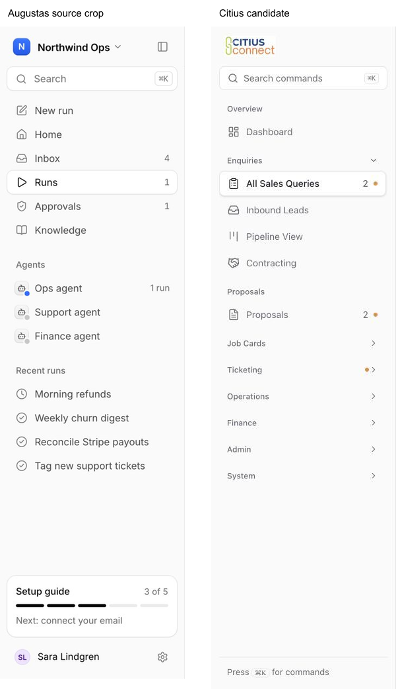
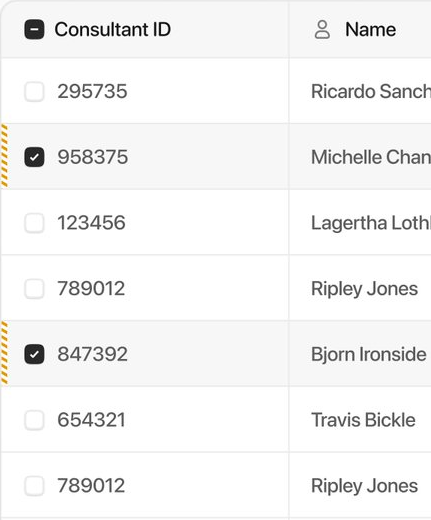
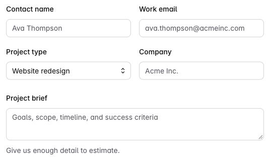
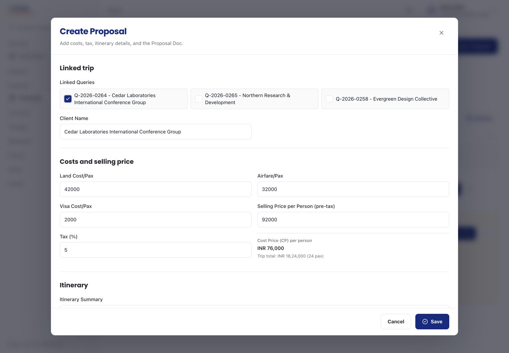
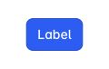

# CRM redesign review in progress

These pictures show the current local candidate, using actual Citius components and fictional trips. The implementation is still under test and has not yet been published with these pictures. Data transport, Next navigation and image delivery use local substitutes. This is not a real signed-in session or provider acceptance.

## U06. A quieter workspace

The sidebar, page headings, search, tables, fields and actions use a shared presentation. Page titles sit directly on the page. Cards remain around separate work modules. Every existing destination and its role visibility stays available. The public site and Customer Account keep their own visual language.

The main reference is [Augustas's Northwind Ops](https://x.com/augustasdesign/status/2109844574613200974). The actual archived image is 960 by 1200 pixels; the sidebar crop is x0, y0, width341, height1200, normalized to280 pixels wide. Citius follows its light rail, outlined active row, muted icons, compact group spacing and right-edge count. Citius retains its logo, configured fonts and actual grouped navigation. Desktop links are36 pixels tall; touch targets remain44 pixels. Search commands opens the existing command palette.

The user's supplied placement image, Library libfile_80621dfeaed88191ae1d6d9720059d78, shows a right-aligned gray count. The orange dot is the separately requested addition beside that count. No Runs destination was added.

The populated query table puts Stage before less urgent columns, so it stays readable beside the pinned actions. Pinned cells use opaque backgrounds. Explicit scroll controls reveal the other columns; all columns and actions remain available.

Table reference: [Akash's table](https://x.com/a1x45h/status/2103785018636329085), actual900 by1200 image, crop x469, y130, width431, height520. Citius follows the quiet header, thin rules and compact row controls. It retains stage colors, business columns and named actions. This is a close component adaptation rather than a full screen copy.

Form reference: [Intent UI's grid fieldset](https://design.intentui.com/patterns/fieldset/with-grid-layout), from bookmarked designer Irsyad. The actual light browser crop is x532, y290, width540, height320 at1280 by720. White outlined fields,8-pixel corners, labels above fields, two-column groups and full-width notes carry across. Citius uses wider business content, its existing validation and44-pixel controls. No new component library was installed or paid source accessed.

| Actual source region | Citius proposal form |
| --- | --- |
|  |  |

Buttons follow the [Intent UI primary button](https://design.intentui.com/patterns/button/primary), actual crop x740, y410, width120, height76. Citius retains navy for the explicit primary action, with quiet outlined secondary actions.

## U07. Keep a pending save safe

Save remains an explicit action. During a pending save and its short saved feedback, the existing form pauses editing, closing and duplicate submission. Failure keeps the draft and restores explicit retry. This changes neither the command payload nor its business stage or approval authority.

The proposal keeps its linked queries, cost calculation, selling price, tax, itinerary and document workflow. The phone dialog occupies the viewport and scrolls internally. The footer stays visible, and keyboard navigation reaches the final itinerary field above it. Tab from Save wraps to Close; Escape closes an idle dialog. Screenshots below are viewport captures, not captures beyond a fixed overlay.

| Phone, top | Phone, final fields |
| --- | --- |
|  |  |

[Narrow360-pixel viewport](crm/proposal-360.jpg). At390 by844 and360 by780, the dialog matched the viewport, the document had no horizontal overflow, and the background remained at scrollY0 with the root scroll locked.

## U08. Carry the selected Job Card into a new form

A new operational form starts with the currently selected Job Card only when it is still available in the loaded choices. Explicit record links, edits and linked traveller context take precedence. Office expenses keep their existing meaning. This prefills context; it does not create or submit a record.

## U09. Workload and new activity

The gray number means work still needing attention. The orange dot means relevant new activity. Opening a loaded destination clears its captured activity, while preserving the count and inbox state. A later arrival restores the dot. The entire link is the target, with an accessible New activity label.

This implementation remains under review. The current notification-window approach needs persistent activity handling so that unrelated notifications cannot evict older unseen activity. It is not ready to publish as a finished feature.

## Validation and remaining work

Focused evidence so far:10 registered Convex integration tests, plus36 Bun checks for navigation, UI primitives, notification cleanup/read receipts and capability registration. These are separate from browser checks. The full gate found the expected source fingerprints and older cleanup/style assertions that needed updating. Its next passing result is still pending.

The broader staff journey audit, refreshed populated detail and operational screens, controlled mutations, final local gate, hosted checks and signed-in target limits remain to be recorded. The current pictures prove these specific component layouts, not whole-site acceptance.

The earlier notification centre used Nick's compact Unread/All centre, Rico's activity separation and Augustas's secondary status view as adaptations. U01 to U05 retained the existing Citius presentation. This redesign's sidebar and content references are the specific sources described above.
