# A simpler Citius Connect

The CRM now uses a compact sidebar, flat page headings, quieter fields and tables, and one prominent row action with the other actions in More. The public site and Customer Account keep their own presentation. U01 to U05 remain in the [earlier usability review](site-usability.md).

These pictures show actual Citius components and CSS with fictional staff and trips. API transport, authentication, Next navigation and image delivery use local substitutes. They do not prove a real signed-in session or provider acceptance. Business stages, permissions, approval authority, required fields, calculations and deletion confirmations stay in place.

## U06. A quieter workspace

The sidebar keeps the Citius logo, destinations and role visibility. Search commands opens the working command palette. Screens without that palette do not show a nonfunctional search control or shortcut hint. Desktop rows are compact; phone controls keep usable touch targets.

| Earlier Citius layout | Current Citius layout |
| --- | --- |
| 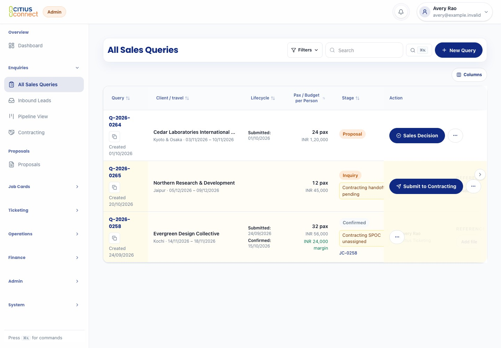 |  |

The Query table places Stage before secondary columns. Pinned cells are opaque, so underlying text cannot bleed through. Columns and scroll controls share one compact toolbar. Inner horizontal scrolling keeps every business column available.

| Query table | Proposal form |
| --- | --- |
| 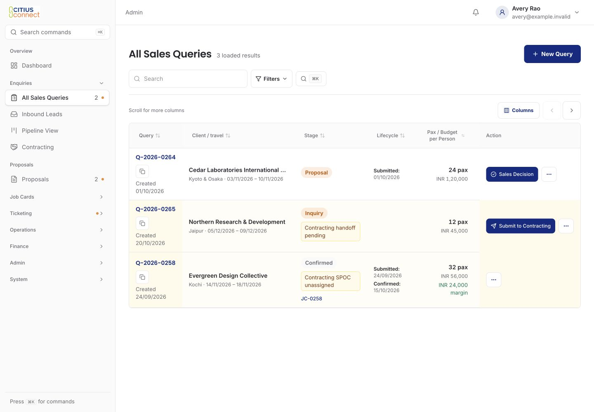 | 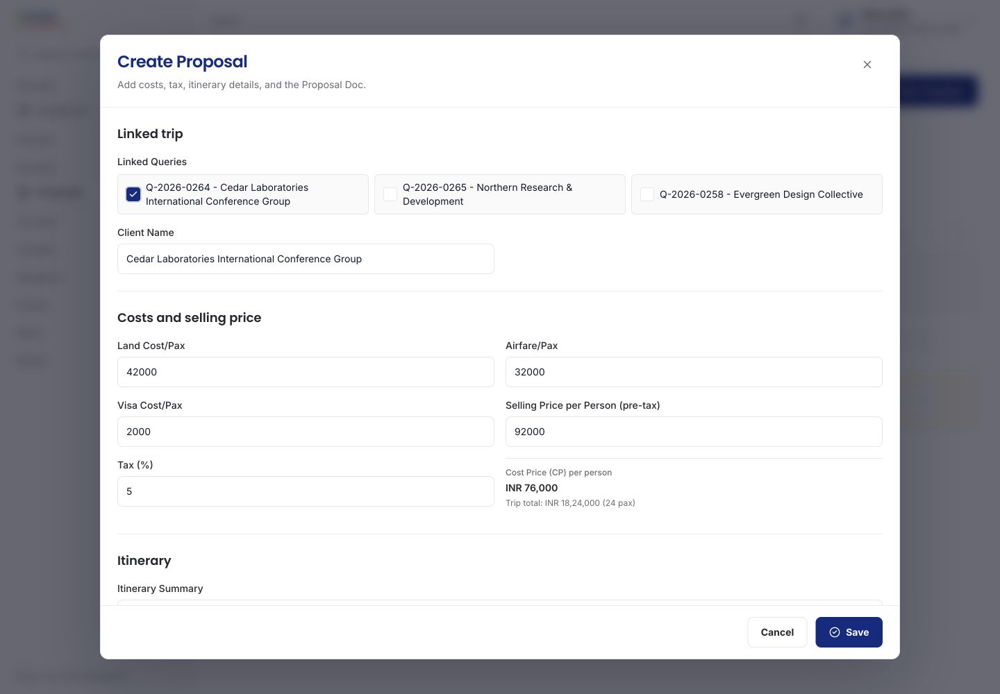 |

Forms have labels above their fields and separate related groups. Required fields, existing values, validation and actions remain. Proposal rows keep the main handoff action visible, with less frequent actions in More.

| Job Card details | Details on a phone |
| --- | --- |
| 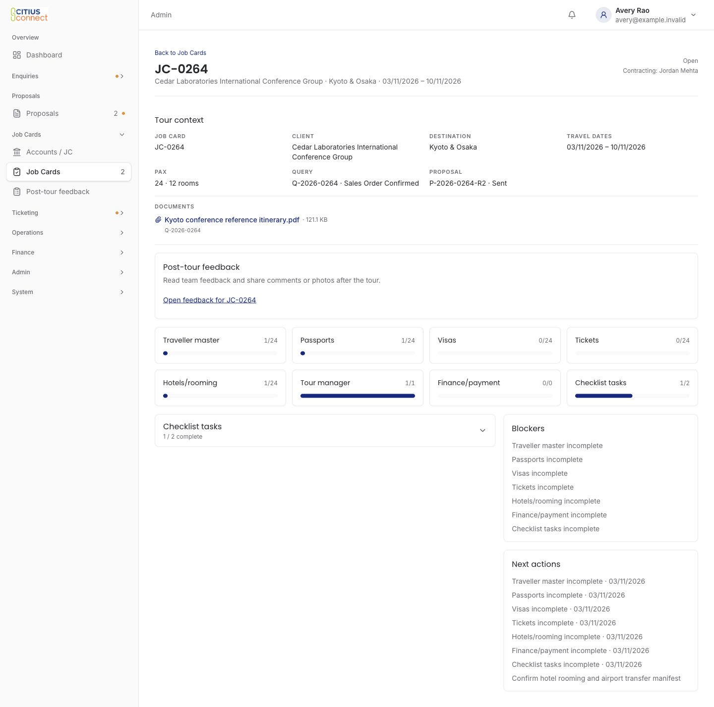 |  |

Cards separate distinct content. The collapsed Job Card checklist no longer stretches into a blank card beside the next-actions list. Post-tour selectors sit directly on the page. Public-site and Customer Account presentation stays separate.

## U07. Keep a pending save safe

Save remains explicit. While a command is pending and during its short saved feedback, the form blocks late edits, duplicate submits, closing and replacement by another form. Failure retains the draft and restores explicit retry. Native inputs and custom linked-query, role and extra-alert checkboxes all reflect the disabled state.

The proposal retains its linked queries, cost calculation, selling price, tax, itinerary and document workflow. The phone dialog matches the viewport and scrolls internally. The footer stays visible. Keyboard navigation reaches the last itinerary field above it; Tab from Save wraps to Close. Escape closes an idle dialog. These are viewport screenshots, not captures beyond the fixed overlay.

| Phone, top | Phone, final fields |
| --- | --- |
|  | 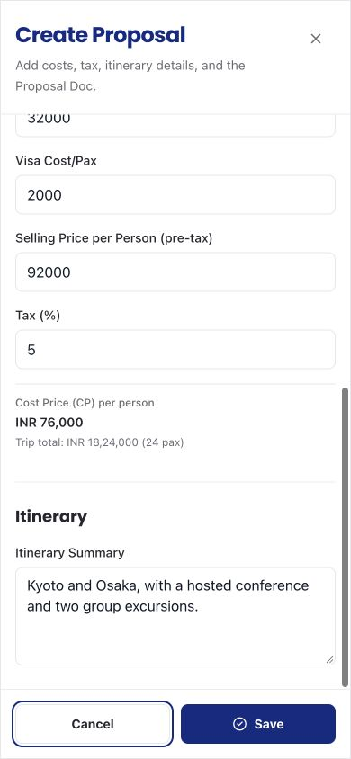 |

[Narrow 360-pixel viewport](crm/proposal-360.jpg). At 390 by 844 and 360 by 780, the root scroll stayed locked and the document had no horizontal overflow.

| Pending | Failed save |
| --- | --- |
| 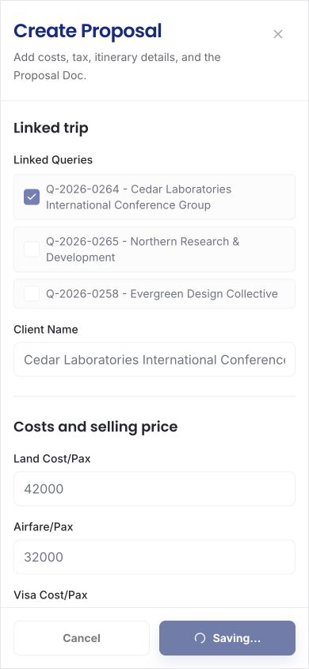 | 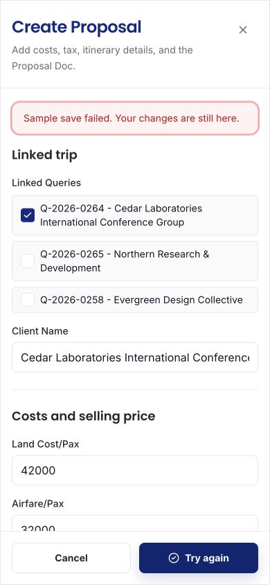 |

## U08. Carry the selected Job Card into a new form

A new operational form starts with the explicitly selected Job Card only when it remains available in the loaded choices. Explicit record links, edits and linked-traveller context take precedence. Office expenses keep their existing meaning. This saves repeated selection; it does not create or submit a record. Regression checks cover seven operational form kinds and rejected or unavailable context.

## U09. Workload and new activity

The gray number means outstanding work in that destination's existing workflow. The orange dot means relevant arrivals since that person last opened the loaded destination. Opening the link clears only the captured activity. It preserves the workload count, inbox read state and business records. A later arrival restores the dot. The whole row is clickable; New activity has an accessible label and no animation.

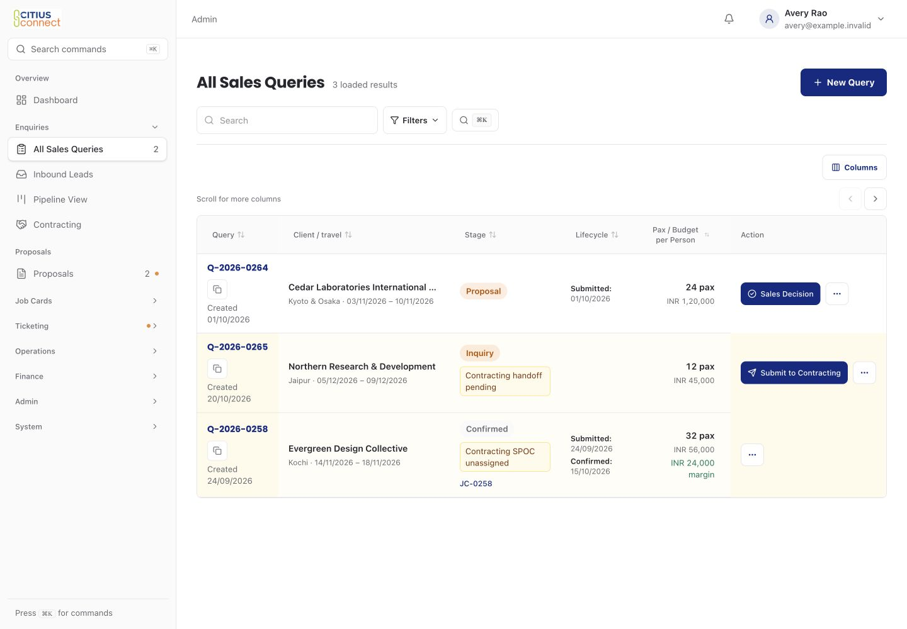

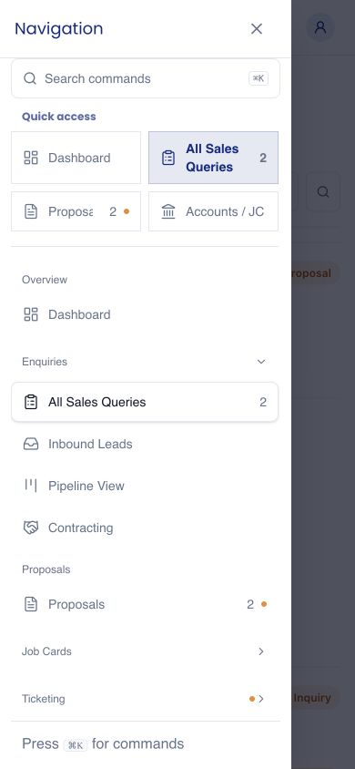

Counts are established for Queries, Contracting, Draft Proposals, open assigned or unallocated Job Cards, Tickets needing attention, and the Ticketing overview. Current assignment, record access, role visibility and active staff determine scope. Unassigned work appears for the relevant heads. Overlapping assignments count once. Other destinations have no fabricated count.

Reads are bounded. A complete count shows its number. A positive incomplete count shows at least that number. An incomplete zero shows an ellipsis with an accessible explanation, rather than claiming there is no work.

Activity persists per person and destination, outside the bell's limited recent feed. Thirty unrelated notices cannot evict it. The real controlled notification publisher records it atomically, using current authorized recipients and record access. Disabled bell controls create no new marker. Existing bell history is not backfilled. The new table is code only; no target migration or deployment was run.

Activity records a historical arrival. If work later closes or moves to someone else, the workload count changes; the arrival dot can remain until that person visits. A proposal sent to its assigned Sales owner can therefore produce a dot with no Draft proposal count. Acknowledgement checks current route permission and staff identity. Hover, prefetch, failed navigation and merely rendering the sidebar do not acknowledge it. An exact captured ID prevents an old acknowledgement from clearing a newer arrival.

## U10. Find the next commercial action

Proposal rows show Send to Sales when the existing Draft and linked-query rules permit it. Files, Edit, collaborator sharing and Delete remain in More. Contracting rows show Assign for unallocated work when allowed, otherwise their existing Status action. Every permission check and exact record/revision target remains. Delete still reaches its existing confirmation.

| Proposal rows | Contracting on a phone |
| --- | --- |
| 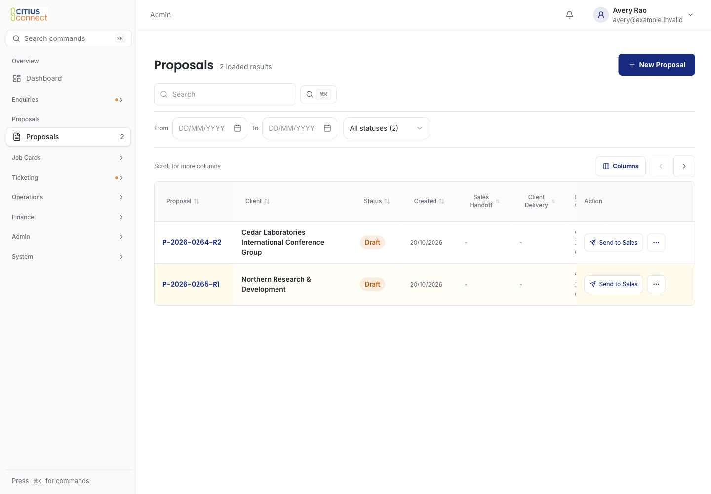 | 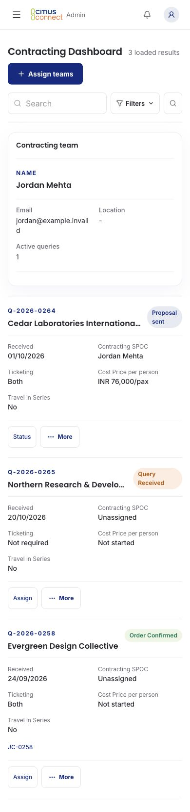 |

[Open Proposal action menu](crm/proposal-actions-1440.jpg). Mounted checks exercise the actual actions, exact targets and read-only Files-only access. They also retain the heads' allocation path. No new approval power or workflow stage was added.

## U11. Keep the person fixed while saving travel

The actual travel form left Person enabled while its other fields and Save paused. It now disables Person too. A failed save restores the selected person, destination and dates for explicit retry. Permissions, Job Card linking and mutation meaning are unchanged.

| Before, during save | After, during save |
| --- | --- |
| 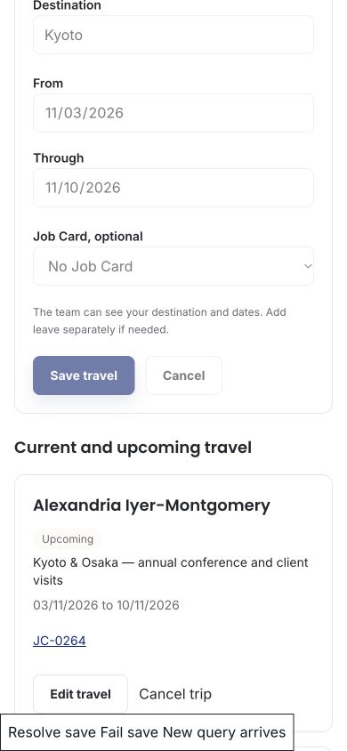 | 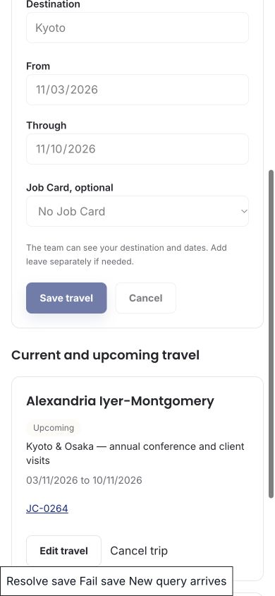 |

[Failed-save recovery](crm/travel-failure-390.jpg). This was reproduced through the actual component with a deferred synthetic mutation. It is browser evidence, separate from the backend travel tests.

## Staff journey coverage

The [59-route inventory](site-coverage.json) retains checked, changed, unchanged and limited areas. The shared shell reaches CRM routes; the populated cases below provide deeper evidence only for their named components.

| Journey | Existing sequence and invariants | Improvement or justified retention | Evidence |
| --- | --- | --- | --- |
| Sales create/edit | Required enquiry and owner data, save, explicit Contracting handoff, Sales-owned decision. | U06 grouped presentation, U07 draft protection, compact row actions. No extra questions or automatic handoff. | [Query form desktop](crm/form-query-1440.jpg), [phone](crm/form-query-390.jpg), pilot/save/lifecycle tests. |
| Contracting proposal/revision | Link Queries, prepare costs/itinerary/document, explicit revision-bound Sales handoff. | U06 groups, U07 safety and U10 compact actions. Pricing completeness, tax and confirmation meanings unchanged. | [Proposal desktop](crm/proposal-desktop.jpg), [phone](crm/proposal-mobile.jpg), exact-payload/action tests. |
| Heads assign/reallocate or work | Authorized head chooses department SPOCs, can select self, explicit save. | Existing selectors and guards retained. U07 prevents draft changes during pending allocation. No invented approval role. | [Assignment desktop](crm/form-assignQueryTeams-1440.jpg), [phone](crm/form-assignQueryTeams-390.jpg), existing assignment/role suites and mounted allocation action. |
| Operations Job Card/documents | Accounts opens only from Confirmed Offer; authorized staff view context, documents, readiness and checklist, then perform existing work. | Flat heading and fact layout; U08 carries selected context. Readiness calculations, document access and task completion remain. | [Detail desktop](crm/jobDetail-1440.jpg), [expanded tasks](crm/jobDetail-expanded-1440.jpg), [phone](crm/jobDetail-390.jpg), command-centre/lifecycle/backend suites. |
| Traveller documents | Choose Job Card/person, enter required travel/document data, explicit save. | U06 grouped fields, U07 draft safety, U08 reliable context. No identity or document-access expansion. | [Traveller desktop](crm/form-traveller-1440.jpg), [phone](crm/form-traveller-390.jpg), existing modal/operations suites. |
| Ticketing flight/PNR/ticket | Retain PNR, seats, itinerary/person links and explicit issue/change/refund actions. | Quieter forms/list, current actionable count and loaded-ready activity handling. Ticket status, allocations and calculation meaning unchanged. | [PNR phone](crm/form-pnr-390.jpg), [ticket phone](crm/form-ticket-390.jpg), [list](crm/tickets-1440.jpg), mounted Ticketing and scoped-audience tests. |
| Finance expenses/approvals | Explicit expense/proof submission, existing manager/Finance approval and reimbursement sequence. | Shared form/list presentation and context prefill. Amounts, authority and approval outputs retained. | [Expense phone](crm/form-expense-390.jpg), [expense list](crm/expenses-1440.jpg), [approvals](crm/approvals-1440.jpg), existing finance suites. |
| HR leave | Existing request, head/HR/final decision stages and authority. | Presentation only; no routing or authority change. No general Management copy rule added. | [Leave form](crm/form-leave_create-390.jpg), [list](crm/employees-on-leave-1440.jpg), mounted two-stage/final-authority regression and backend suites. |
| Staff travel | Choose person, dates, destination and optional Job Card, explicit save. | Flat heading and U11 pending-person fix. No automatic assignment or record creation. | [Desktop](crm/staffTravel-1440.jpg), [phone](crm/staffTravel-390.jpg), failure recovery above and backend travel suite. |
| Manager profiles/history | Existing profile and assignment history, explicit management actions. | Flat page heading and shared field presentation. Experience and completed-tour meanings retained. | [Desktop](crm/externalManagers-1440.jpg), [phone](crm/externalManagers-390.jpg), existing manager-profile suite. |
| Post-tour feedback | Choose authorized Job Card; preserve separate traveller responses and manager reports, explicit save/upload/delete confirmation. | Flat selector and consistent report cards. No invitation, upload or deletion executed against a provider. | [Desktop](crm/postTour-1440.jpg), [phone](crm/postTour-390.jpg), existing mounted/backend feedback suites. |

Dashboard, inbound/event tools and other routes inherit the CRM shell where used, but are not claimed as independently accepted signed-in journeys. Public/Account usability remains U01 to U05; their visual identities stay separate. Parked PRs and rejected product features remain parked. No analytics was enabled.

## U12. Omit an unrelated empty-record message

The signed-in Notifications page no longer announces an empty activity-log count beneath a populated personal inbox. Empty lists omit that footer, while real Load more actions remain. A mounted regression, a restored controlled mutation and the real local inbox check cover it. See the [local results](local-acceptance.md#u12-remove-an-unrelated-empty-record-message).

## Verification and limits

The [signed-in local gallery](local-acceptance.md) shows the real inbox, bell, Query deep link, head self-assignment and phone count/dot. All 28 selected workflow checks passed. Earlier loading/error pictures still use component substitutes; hosted Preview access is not a local acceptance requirement.

[Browser evidence](crm-browser-evidence.json) identifies current image hashes and substitutes. The [loading state](crm/queries-loading-1440.jpg), [empty state](crm/queries-empty-1440.jpg) and failed-save pictures are distinct. Earlier before pictures use the pre-redesign components; some have fewer sample rows than the populated final pictures. Compare composition, not those sample business outcomes.

[Six controlled mutations](crm-mutation-evidence.json) caught stale server acknowledgement, missing real-publisher projection, a moving client snapshot, enabled pending checkboxes, missing Job Card prefill and a lost Proposal revision. Every original file was restored byte-for-byte and its focused suite passed afterward. These are separate from the four earlier U01 to U05 mutations and ordinary passing tests.

The final local gate passes with Effect 4.0.5: 2,060 Bun tests, 225 schema-backed Convex tests, zero-warning lint, application/Convex types, and coverage for six high-risk files and 29/29 branch contracts. The existing dead-code check passes at 132/183 reviewed findings, with no baseline update. Diff hygiene passes. The PR records the exact published revision and hosted result separately.

The first upgrade run correctly rejected the old dependency-closure fingerprint. The existing repository calculation refreshed it, without weakening its test. A later React Doctor check found the compiler limitation described below; the complete local gate passed again after that fix.

React Doctor's changed-code check now has zero errors and seven advisory notes. Its unsupported `finally` clause was replaced by explicit pending-save resets on success and failure; the actual save/retry tests pass. No diagnostic rule or baseline was weakened. Advisory notes concern array iteration/lookups, sequential fixture setup and deliberate callback identity for the readiness subscription.

The dependency audit reports existing advisories in ten packages: brace-expansion, braces, DOMPurify, follow-redirects, KaTeX, Next.js, sharp, source-map-js, undici and Vite. Their installed versions match the pre-change lockfile, and the audit lists no Effect advisory. This is an audit failure for the existing dependency set, not a clean dependency-security result or an assessment of application reachability. Unrelated package upgrades are outside this Effect update.

The existing ignore rules already cover the local fixture, caches, logs and test outputs. No new ignore rule is warranted. Intended source, regression tests, review pictures remain tracked.

These component checks do not prove a production build or provider acceptance. The separate signed-in local run used the actual Next dev server and locally deployed PR functions/schema, with no hosted backend write. No real record, email, charge or live control was used. The draft grants no merge or production deployment authority.
