# The notification inbox

These pictures show the current Citius components in the user's Mac browser, with fictional people and work. The local review substitutes sign-in, server responses and navigation. No test account signed in and no email was sent. The signed-in target check below remains blocked.

## Unread and All

Unread shows the updates still needing to be opened. All also shows read history. Switching to All left both unread updates unread and made no read request.

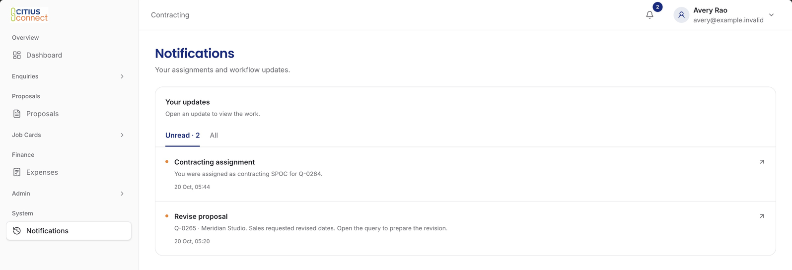

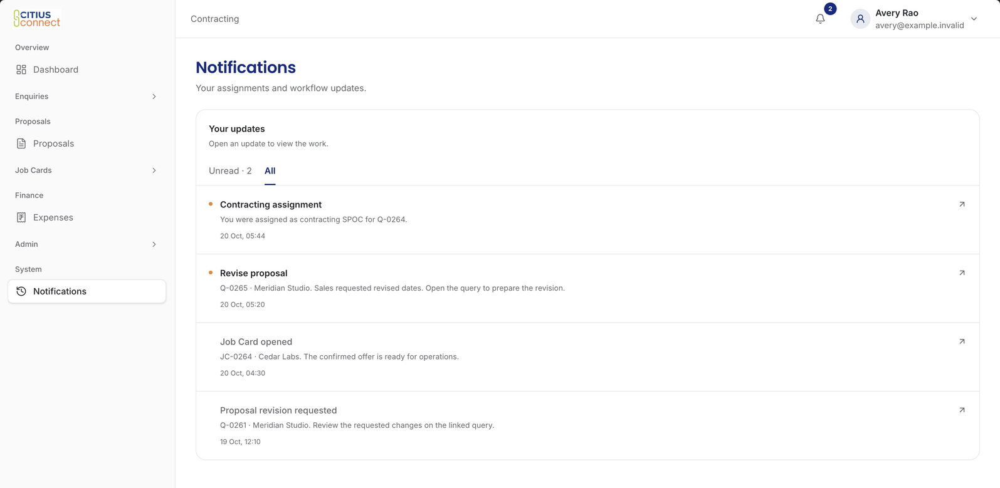

## The same inbox on a phone and in the bell

The Notifications page and bell use the same inbox. Opening the bell preserved the unread count. The phone pictures use a 390 by 844 viewport.

| Notifications page | Bell |
| --- | --- |
| 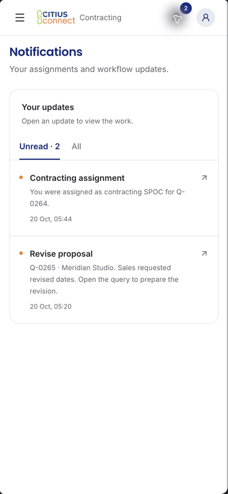 | 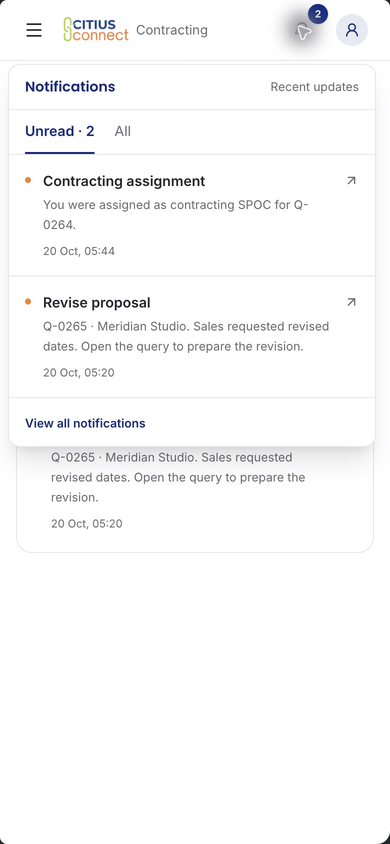 |

Opening the Contracting assignment marked only that update read. The other update stayed unread, and the component requested `/portal/queries?open=query&id=demo-query`. A later synthetic arrival increased the unread count again without another read request. The local navigation substitute recorded the requested link; this does not prove the destination loaded or authorized the record on a deployed backend.

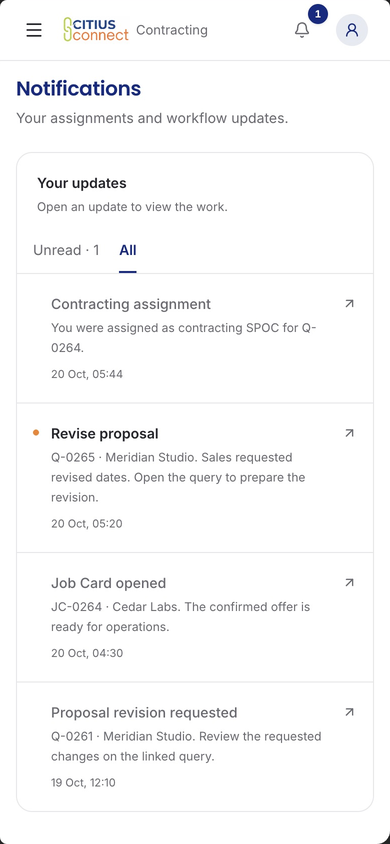

## Empty, loading and failed requests

No history and no unread work are different states. The latter offers access to read updates. Loading shows placeholders instead of a false empty message.

| No history | Read history remains | Loading |
| --- | --- | --- |
| 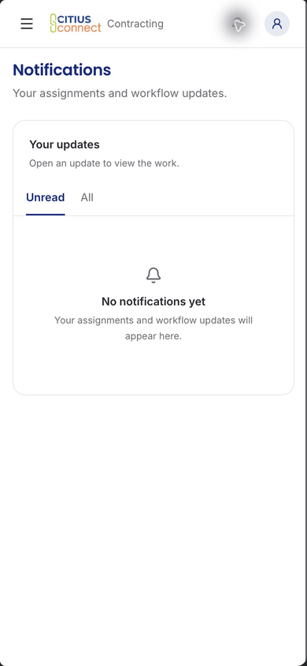 | 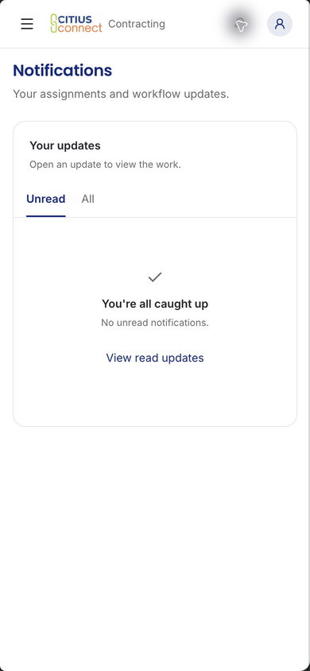 | 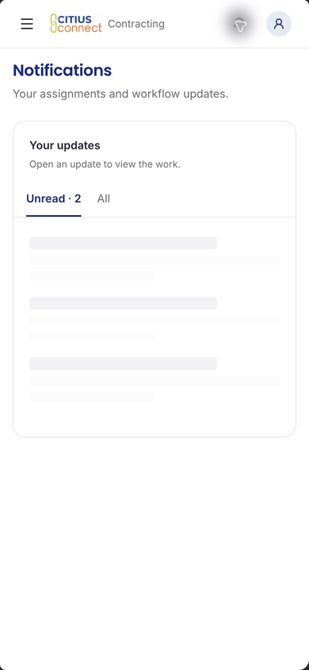 |

The error example supplies the existing page error banner and rejects a synthetic read request. Activating the update left both items unread. It checks the inbox's failed-read behavior and error layout, not a deployed transport's error reporting.

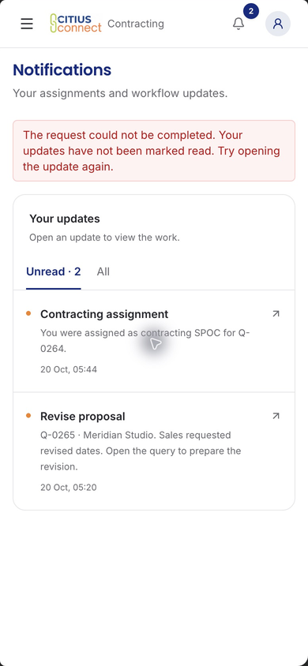

## Staff and authorized email-status views

The Ticketing example shows assigned ticket attention and reminder content. Ordinary Contracting and Ticketing views have no email-delivery panel. An Admin example shows email status separately from the personal inbox. Its accepted/retrying values are sample responses, not provider receipts. Accepted means the service took the email; it does not confirm delivery to a mailbox.

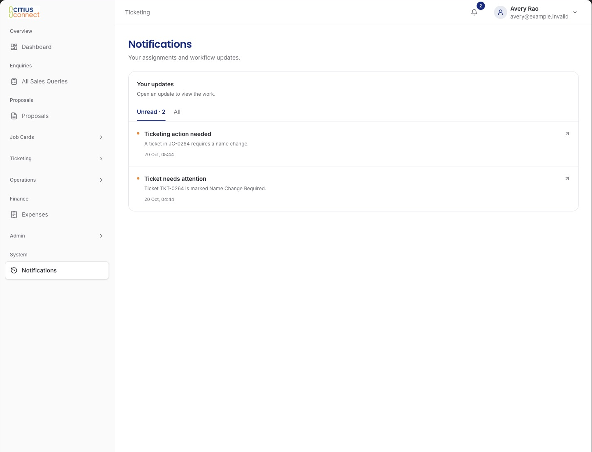

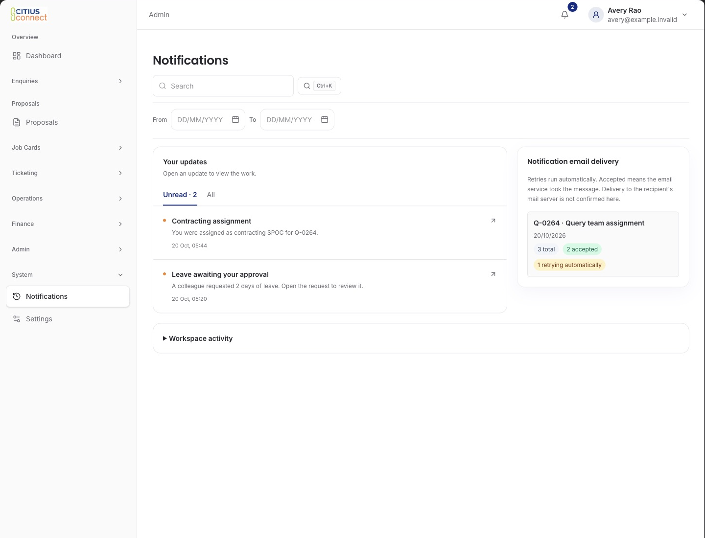

These role pictures check presentation. They do not prove recipient separation by putting different lists into the review. The registered backend tests separately cover exact audiences, unrelated staff, overlapping roles, reassignment, inactive staff, record access and head fallback. The [recipient rules](README.md#recipient-rules) retain their R01 to R15 review anchors.

## Signed-in target check

Existing designated test profiles, password settings and saved role-session files were found. No secret value or session content appears in this review.

The only approved preview manifest binds an older frontend revision and a different backend source fingerprint. Opening that preview's read-only identity endpoint in the Mac browser reached Vercel's "You Need Access" page. No credentials were entered, no access request was sent, and no seed or business mutation ran. Its current runtime revision could not be verified.

A stopped loopback backend was also found, but it has no approved local target binding and its data is unclassified. The configured development backend is hosted. The test guard does not permit pairing a loopback frontend with that hosted backend as a local test target. Neither backend was started or modified.

GitHub subsequently reported an automatic Preview deployment for gallery commit `e87c6860fcf10f6470a11c4874a99e507d24fb83`. Its read-only identity endpoint also reached "You Need Access" in the Mac browser. This discovery narrows the next step to approved access to that existing Preview, followed by verification of its frontend revision, backend fingerprint and isolated test-account setup. A new frontend deployment is not established as necessary. Whether backend deployment or fixture setup is needed remains unknown until those identities can be read. No access request or settings change was made.

A supported local alternative would require separately approved preparation of an isolated loopback backend, PR function/schema deployment, exact revision binding, and the designated test-account fixture and cleanup lifecycle. That is a fallback, not a prerequisite established by this review. Existing account authorization alone does not establish that production runs this unmerged PR.

## Pictures and evidence coverage

| Claimed change | Actual picture or comparison | Evidence and remaining limit |
| --- | --- | --- |
| Shared inbox, Unread/All, selected read, bell, late arrival, failed read | The desktop and phone pictures above | Current components in the Mac browser with synthetic transport and navigation. No signed-in destination acceptance. |
| Assignment, leave, Tour Manager and ticket emails | [Email examples](README.md#the-emails) | Production HTML with fictional values from the earlier notification review. No provider or mailbox acceptance. |
| Heads can take their own work | [Self-assignment picture](README.md#r03-direct-job-card-assignment) | Actual selector and registered assignment/work tests. No current signed-in target run. |
| Recipient, retry and deduplication rules | [R01 to R15](README.md#recipient-rules) | Schema-backed and controlled-mutation evidence. A screenshot cannot prove audience or delivery guarantees. |
| Staff filters, Account editing, Contact and Services | [U01 to U05 before/after](site-usability.md) | Actual components and focused behavior tests. Their distinct visual designs remain. |
| Sidebar, search, count/dot, table, forms and detail layout | [U06 to U09 source comparisons and pictures](crm-redesign.md#u06-a-quieter-workspace) | Populated desktop and phone components, with original reference crops. Per-person count/dot tests are separate from inbox read state. |
| Proposal actions, operational context, pending-save recovery and travel | [Staff journey pictures](crm-redesign.md#staff-journey-coverage) | Current forms, lists and custom screens with regression tests. Target-bound workflows remain unaccepted. |

[Machine-readable evidence](inbox-browser-evidence.json) records the exact source revision, substitutes, observations, crop bounds and image hashes. Browser chrome and private account identifiers were excluded from the published crops. The gallery adds review evidence only; it changes no application behavior.
