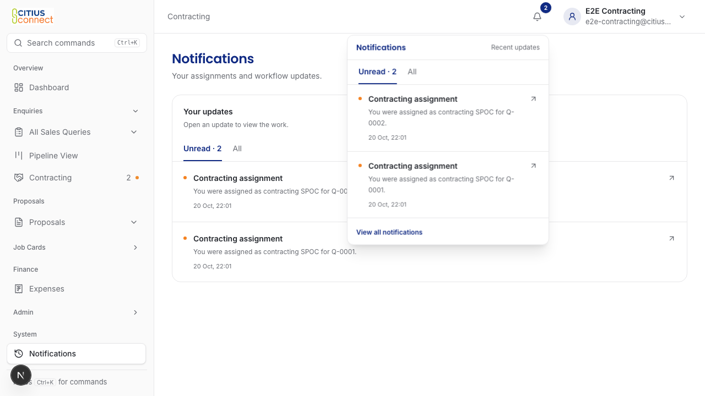
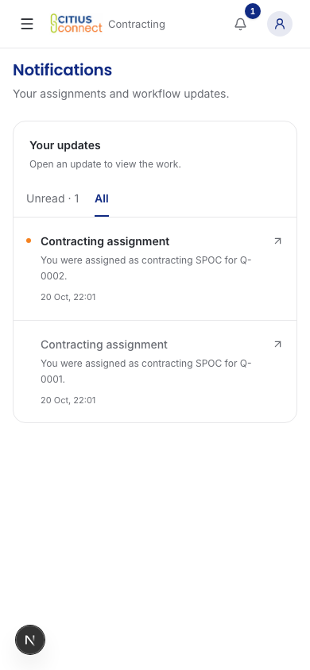
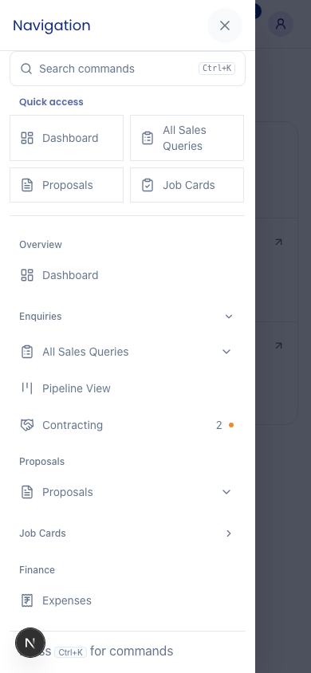
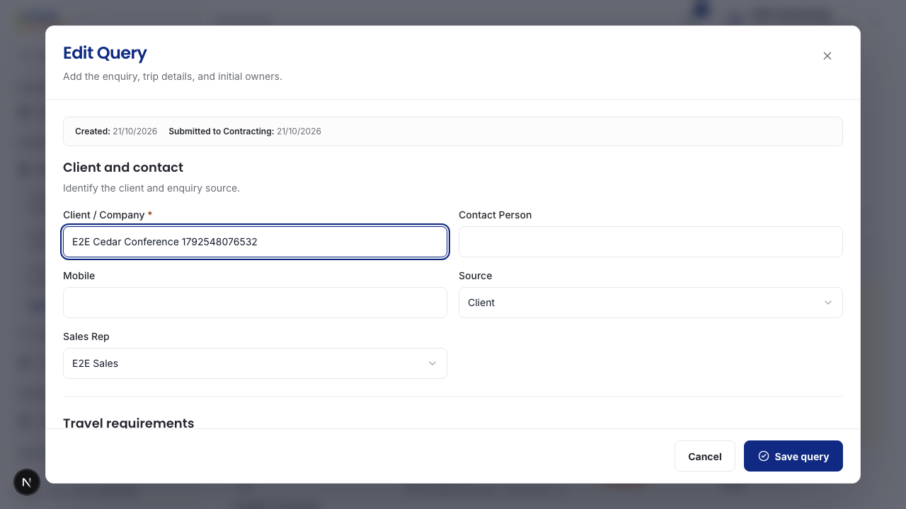
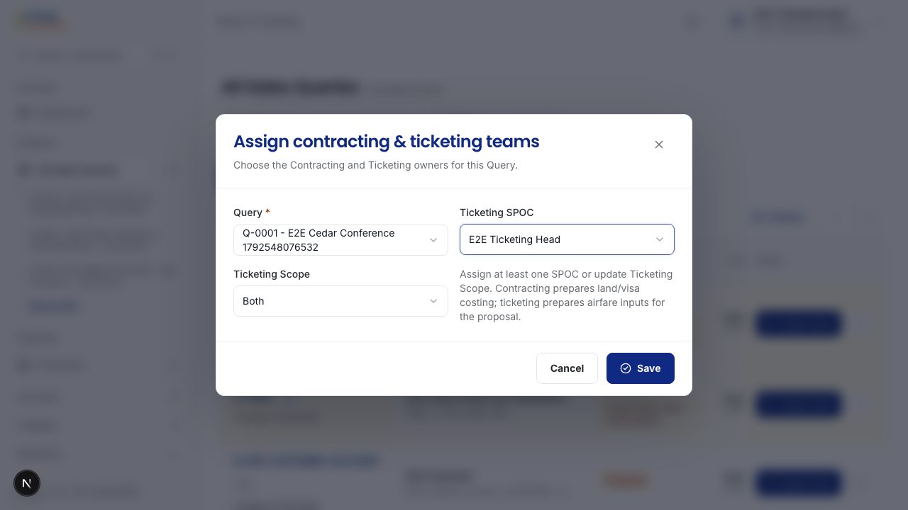

# Signed-in local checks

The existing test accounts now run against the real Citius app and a fresh local test database. The main workflow run passed all 28 selected checks, with no failures or skips. A final inbox run also passed after ordinary keyboard entry of the Query notes. These checks used fictional staff and trips. They sent no email.

## The inbox and bell

Sales created these Queries through the normal form. Contracting received the resulting assignments from the real backend. Opening the bell preserved both unread updates.

Opening one update loaded its authorized Query and marked only that update read. The other update stayed unread. All retained the read update. A later assignment restored the orange sidebar dot.

| All on a phone | Work count and new activity |
| --- | --- |
|  |  |

## Who received the Query

The signed-in check inspected all 12 designated staff profiles before any later reassignment. The assigned Contracting SPOC, Directors account, Operations Head and Head of Ticketing each received one intake update. Sales, ordinary Operations, ordinary Ticketing, Finance, Accounts, HR, Sales Cement and Contracting Cement received none for that Query.

The fixture named "Admin" has the Directors role. This run proves its Directors behavior. The separate Admin role and overlapping-role deduplication retain their registered backend tests; this fixture does not prove those combinations in a browser. The Query used Ticketing Scope "Both". There was no whole-team recipient list.

Head of Ticketing then chose themselves as Ticketing SPOC, saved, reopened the assignment and retained their selection. The check kept that later assignment event separate from the initial intake audience.

## Workflows that passed

| Journey | Existing steps and outputs checked |
| --- | --- |
| Sales and Contracting | Create a Query with an attachment, series details and Ticketing scope. Assign Ticketing. Draft a Proposal, send it to Sales, revise the trip and record the confirmed offer. Contracting cannot take the Sales Decision. |
| Accounts and Operations | Open the Job Card from the immutable confirmed offer, retain the assigned Sales initials in its number, assign Operations, create and edit a traveller. Destructive deletion still requires holding the confirmation control. |
| Ticketing | Create a synthetic ticket, edit it and retain the saved number. No airline or payment provider was called. |
| Finance | Create an owned draft expense. Submitting for approval remains a separate available action. |
| Leave | Submit a leave request, obtain the configured head approval, then HR final approval. No approval authority or routing changed. |
| Customer Account | Show the customer's explicitly granted trip without staff or payment details. Keep Customer Account and Staff authority separate. |
| Mobile | Eleven staff roles open their existing destinations without page-level horizontal overflow. Navigation and account menus restore keyboard focus. Sales Decision and More remain reachable. |
| Inbox and sidebar | Opening the inbox or bell does not read items. All preserves unread state. Activating one item reads only that item and opens its Query. Refresh and hover preserve the dot. Successful destination loading clears the dot while the work count and inbox unread state remain. A later arrival restores it. The phone drawer follows the same rule. |

The local assertion helper now supports an explicitly bound loopback backend without looking up a hosted project. Local assertions still reject production, cloud aliases, cloud deployment keys and mismatched origins. Hosted Preview access is not a prerequisite. Test ownership, exact code identity and cleanup checks remain.

## U12. Remove an unrelated empty-record message

Signed-in review found "0 authorized records loaded" beneath a personal inbox that had two updates. That message counted an empty activity-log list, not the person's notifications. Empty lists now omit that redundant footer. A real Load more action remains available when more records exist. The inbox, recipients and workflow stages do not change.

The new mounted regression test fails when the old footer returns. The controlled mutation was restored byte-for-byte before the passing local run.

## What these checks do not prove

The local app used the actual Next server, Better Auth, Convex schema/functions and browser navigation. The automated browser used only the designated test accounts. The earlier native Mac-browser check also signed in as Sales and saved a Query. This work never started or copied the original local database, and its hash stayed unchanged. A new task-owned database held the synthetic records.

Loading and failed-read pictures in the [earlier inbox gallery](inbox-review.md#empty-loading-and-failed-requests) still use component substitutes. They show those states and their regression tests. This local run did not force every backend transport failure. Email audiences, reassignment before retry, deduplication, disabled controls and race protections retain separate schema-backed and controlled-mutation tests. No provider acceptance, mailbox delivery or production configuration is claimed.

One native-browser Notes entry logged a repeated-update error while a writing extension was active. The cause remains unisolated. It did not recur in the isolated browser's normal keyboard-entry check, which captured page errors and verified the exact saved Notes text. No speculative extension or form rewrite was applied.

The 59-route source audit remains broader than the signed-in checks above. Unlisted routes, password recovery, external providers and production are not accepted by this run. No new access credential, hosted setting, production record, real message, analytics, merge or production deployment was used.

Exact revisions and local evidence

The complete 28-check run used `e85155c4721051fb19358384bb4f283950ed24b3`. The final keyboard-entry and inbox scenario used `d7a45730771d6aeb37d17818194266391c78f996`. Application behavior is unchanged between those commits. The latter changes only how the test types Notes. Published application work remains based on `59b488628b3ecfd7273924e6ea95afb637038e58`, with the small footer correction in `e85155c4`.

The frontend was `http://127.0.0.1:34000`. Its isolated backend used loopback API port 34210 and HTTP-actions port 34211. The target was `development-local-pr297`. Both identity checks passed before each seed. The backend's code-baked source fingerprint was `f8c21c3663a1859618e70a2091d97ccb90f28e10cc35175c616b64ad2d2d4c78`. Node 24.21.0 and Bun 1.4.0 ran the local setup. No provider keys were present, and active E2E ownership suppressed outbound notification scheduling.

Each run used the repository seed and cleanup lifecycle. The final aggregate audit found zero active runs, zero owned rows and zero notification outbox rows. Private environment and auth-session files remain ignored. The complete repository gate passed 2,060 Bun tests, 225 Convex tests, zero-warning lint, application/Convex types and 29/29 coverage contracts on the final tested source. Dead-code limits passed at the unchanged 132/183 baseline. The [machine-readable record](local-acceptance.json) includes the selected commands, proof limits and image hashes. It contains no credentials or user-browser sessions.

