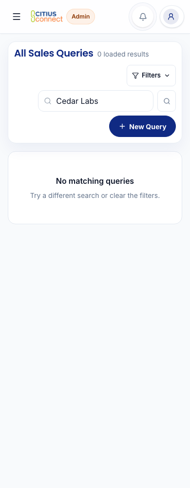
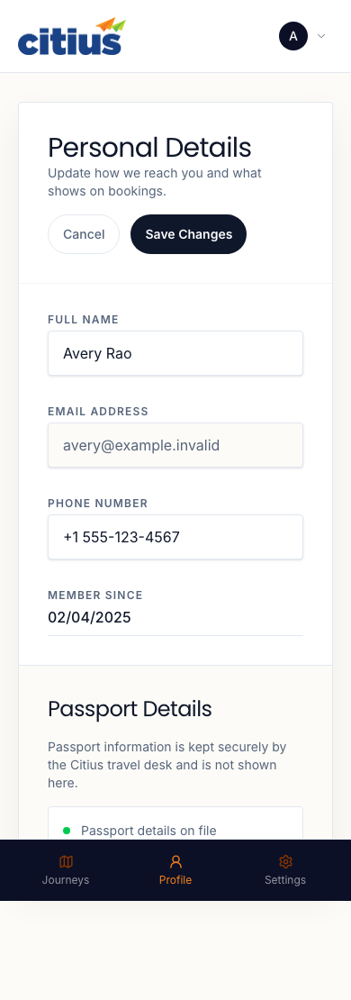
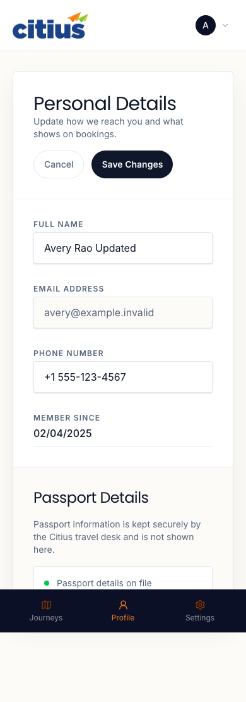
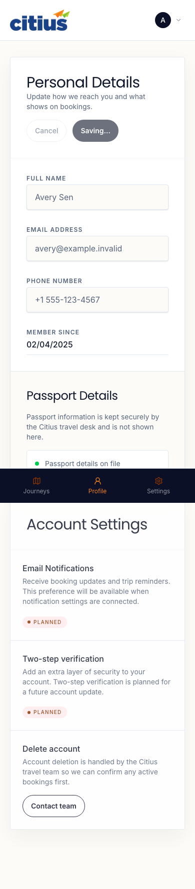
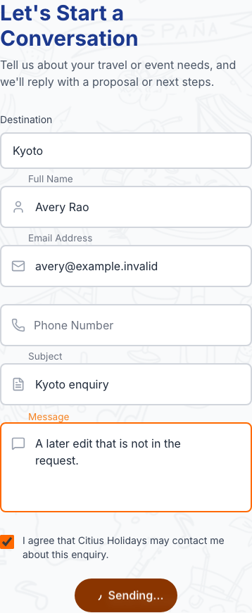
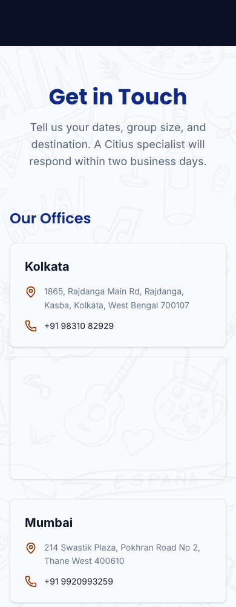

# Existing work, easier to use

This first site-wide pass keeps the team's current workflow. The public site, Customer Account and Staff Workspace keep their separate presentation. Use U01 to U05 for this first pass and U06 to U12 in the [CRM redesign review](crm-redesign.md).

The pictures show actual Citius components with fictional people and trips. Navigation, images and data transport use local review substitutes. These are component checks, not proof of a real signed-in session. No email, booking, charge or live business record was created.

## U01. Clear Staff filters without opening another panel

An active filter can hide every result. Previously, Clear filters was hidden inside the collapsed panel. One reset is now visible beside Filters active, including on search-only lists. It calls the existing reset and preserves the record link in the URL. New query and the other workflow actions stay where they are.

| Before | After |
| --- | --- |
|  |  |

[Desktop before](u01-before-desktop.png) and [desktop after](u01-after-desktop.png). The mounted check exercises the real reset callback for search, dates, Job Card and list filters. It also checks the preserved record link, one reset, and an unchanged primary action.

## U02. Keep Account profile edits safe

Edit starts with the details currently shown. Enter saves through the same Save action. Invalid input receives focus. Fields and Cancel pause while a save is running, then become available after a failure with the draft intact.

Switching between Account tabs keeps the profile draft. A save that finishes while another tab is open retains its result or recovery message. Switching tabs does not submit anything. Email and passport details keep their existing read-only behavior.

| Before | After |
| --- | --- |
|  |  |

The sample was updated to Avery Rao Updated before Edit opened. The earlier field still showed Avery Rao. The after image uses the updated value.

[Desktop before](u02-before-desktop.png) and [desktop after](u02-after-desktop.png). Regression checks retain the same name and optional-phone validation, trimmed PUT payload, duplicate-submit guard, failed-save draft and saved result. Browser checks cover Enter and tab changes during drafts, failures and completed saves. Closing or reloading the browser still discards an unsaved local draft.

## U03. Protect the enquiry being sent

The enquiry fields pause while Send is running. Previously, a visitor could type more while the old values were being sent, then lose the later edit when success cleared the form. A failed send restores editing and keeps the enquiry and retry identity.

| Before, while sending | After, while sending |
| --- | --- |
|  |  |

The fields, consent, security check and explicit submit are unchanged. Tests verify one request, the same Website enquiry payload and retry key, failure recovery and success clearing. An older recovery timer cannot unlock a newer pending request.

[Desktop form](u03-after-desktop.png). This change adds no extra questions, receipt, review stage or automatic send.

## U04. Reach the Contact form sooner on mobile

The existing form comes before the three office maps on a phone. Visual order now follows keyboard order. The desktop order, office details, map links and response commitment stay the same.

| Before | After |
| --- | --- |
|  |  |

Browser checks verify mobile order, retained maps, unchanged desktop order, and the same explicit consented submission.

## U05. Read and choose every service

The circular Services selector stays. The original fixed ring clipped choices on phones. Narrow screens now give the choices more vertical room and show the selected description below the circle. Desktop keeps the description in the centre. All 11 services and their descriptions remain.

Each service can be chosen from the keyboard as well as by pointer. Its accessible name now says Learn about the service.

| Before | After |
| --- | --- |
|  |  |

[Desktop before](u05-before-1440.png) and [desktop after](u05-after-1440.png). Geometry and activation checks cover 320, 360, 390, 400, 500, 768 and 1440px. The narrow view also passed with enlarged text. This does not restore the rejected Services list redesign.

## Coverage

The [59-route coverage file](site-coverage.json) lists every page entry, its changes, the depth of review, what stays the same and remaining limits. A shared-component check is not a signed-in acceptance test for every route that uses it.

| Area | Routes | Checked and changed | Unchanged or limited |
| --- | ---: | --- | --- |
| Staff Workspace | 30 | U01 reaches 23 shared-list routes when their toolbar is shown. The actual Query toolbar and four custom workspaces were reviewed at desktop/mobile sizes. | The deeper [CRM journey review](crm-redesign.md#staff-journey-coverage) now covers populated commercial, operational, finance, leave and custom screens. Other routes inherit the shell where used. Real role sessions and record-specific journeys remain target checks. |
| Customer Account | 1 | U02 covers Profile and tab continuity. Existing Journeys and Settings tests remain. | Entitlements and journey facts remain read-only. The later signed-in local run checks the entitled trip and Profile draft/tab continuity; it does not broaden entitlement access. |
| Public marketing and enquiry | 7 | Contact and Services changed. Home, About, Gallery, MICE and Policies components were checked at desktop/mobile sizes. | Retained composition and content stay. CMS media and the native server layout need target review. |
| Authentication | 7 | Staff, guest and vendor sign-in, forgot-password and missing-token reset components were checked. | Auth rules are unchanged. The later local callback check renders password-reset mail and records provider-not-configured. Legacy redirects, verification tokens and actual recovery delivery remain unaccepted. |
| Vendor | 1 | Existing supplier page checked at desktop/mobile sizes. | The retained placeholder and entry availability stay. No supplier session or new capability. |
| Journal | 2 | Index and article components checked with sample content. | Existing featured layout and article presentation stay. Live CMS content was not fetched. |
| Pilgrimage | 2 | Hub and trail components checked using existing trail data. | Programme, itinerary, enquiry, booking and payment meaning stay. No booking was submitted. |
| Sacred Bharat | 7 | Enabled edition component checked; the six alias/redirect entries were read and retain existing tests. | Live availability and sharing/analytics acceptance remain unverified. No content or control change. |
| Public Photo Booth | 1 | Open and closed components checked. | Capture/export and real-device sharing remain separate checks. No participant photo was used. |
| Public tour feedback | 1 | Missing-token component checked; existing mounted tests cover optional comments, retry receipts and photo recovery. | No real invitation, token or response. |

Prior keep/revert decisions remain in place. Home company/client/logo/award sections, About team and values, Trending rankings, Journal presentation and the circular Services selector remain. Parked PRs #283 and #285 were not merged. No shortlist, new planning draft, extra enquiry fields, proposal stage or Job Card readiness rewrite returned.

## Verification and limits

The [browser evidence](site-browser-evidence.json) records final source and image hashes, baseline reproductions, viewport checks and review substitutes. The [controlled regression evidence](site-mutation-evidence.json) records four deliberately broken behaviors that their tests caught, followed by a passing restored suite. Ordinary passing tests are separate evidence.

The final commit and required local gate result are recorded in the task handoff. The [selected signed-in local workflows](local-acceptance.md) now pass. That run does not accept every route in the source inventory or prove provider delivery. Hosted quality remains separate. This local review grants no merge or production deployment authority.
